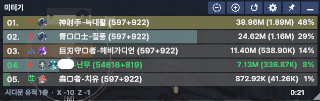
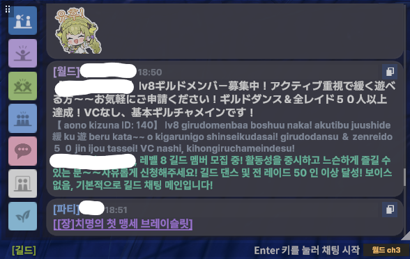
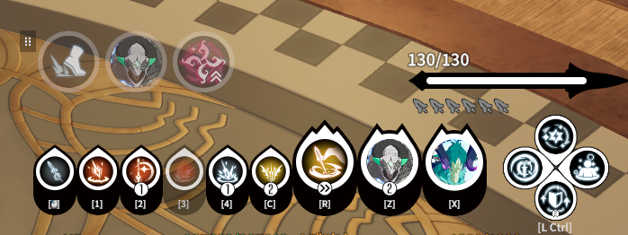

# Star Overlay

블루 프로토콜: 스타 레조넌스 화면 위에 DPS 미터기·채팅·버프 트래커·파티 가입 신청 정보를 보여 주는 인게임 오버레이입니다.

**[최신 버전 내려받기 (Releases)](../../releases)** · 설치 방법은 [아래](#설치)를 참고하세요.

## 번역 프롬프트 예시

번역 프롬프트는 처음에는 비어 있습니다. 채팅 설정의 **번역 프롬프트**(창 모서리의 프롬프트 버튼)에 직접 적어 넣어야 번역 품질을 조절할 수 있습니다. 아래는 게임 단어 사전과 번역 규칙을 담은 예시입니다. 그대로 붙여 넣어 쓰거나 필요한 단어를 고쳐 쓰세요.

```
게임 단어 사전
===
직업 관련{ 威咲=치유, 狂音=음파, 響=협주, 響奏=협주, 森=숲, 双=도끼, 月影=월광,  槍=창, イサキ=심판, 弓=활, 鷹=매, 狼=늑대,
}
파티 관련{ 若葉=새싹(초보자), ナイトメア=나이트메어, @=모집(예시: @たくさん, @いっぱい=많이모집), VC=음챗, 入り=있음, 配信中=방송 중, ボイス=보이스, 巨竜=거룡, 周回=파밍, なん周(週)=몇판, 〆=마감, 麻雀=마작
}
사냥 관련{ ch=채널, 旅人=방랑자, 尖兵=첨병, 邪教=이교도, 宿主=숙주, さめ=상어, 遺影=이형, ギルハン=길드사냥
}
문장 관련{ よろしくお願いします=잘 부탁해요, おつありでした=수고하셨어요, いけるどこまで=갈 수 있는 데까지, 誤爆=잘못쳤어요
}
===
일본어 게임 / 커뮤니티 입력 채팅을 게임 단어 사전을 참고하여 일치하는 단어는 대응되는 한국어만 적도록 하세요. 입력 채팅에 나온 문장은 숫자같은 표현도 빠짐없이 모두 번역되어야 하고, 불필요한 추가 표현은 없어야 해요. 번역된 구처에 한국어 문장을 문법에 맞춰서 출력하세요:
```

## 기능

### DPS 미터기



- 파티원별 순위, 직업과 세부직업, 이름(전투력), 총 피해량, DPS, 지분을 한눈에 봅니다.
- 아래쪽에 지금 있는 장소와 전투 시간이 나옵니다.
- 위쪽 버튼으로 투명도 조절, 초기화, 설정, 고정(핀), 접기를 합니다.
- 설정에서 지난 전투 기록과 스킬별 피해, 버프 기록을 볼 수 있습니다.

### 채팅



- 게임 채팅을 채널별 버튼(왼쪽)과 함께 보여 줍니다. 이름 옆에 작은 회색 글씨로 시각이 나오고, 복사 버튼이 있습니다.
- 일본어 채팅에는 로마자 읽기(IME 변환)와 한국어 번역을 붙입니다. 번역은 설정에서 켜고 끌 수 있고, 끄면 번역 모델이 메모리에서 내려갑니다.
- 전리품 같은 시스템 메시지를 작은 글씨로 보여 줍니다. 설정 맨 위에서 켜고 끌 수 있습니다.
- 아이템 링크(보라색)를 누르면 게임의 아이템 정보창이 뜹니다.
- 이름을 누르면 그 캐릭터의 정보창이 뜹니다.
- 게임의 채팅 입력줄은 채팅 창 바로 아래에 붙어서, 입력과 채널 선택은 게임 방식 그대로 씁니다.

### 버프 트래커



- 추적할 버프·스킬을 골라 둥근 아이콘으로 보여 줍니다(왼쪽 위 아이콘). 남은 시간은 링 게이지와 숫자로, 중첩은 숫자로 나옵니다.
- 설정의 **편집** 탭에서 추적 목록을 추가·수정·삭제합니다. 아이콘은 **모듈 / 이매진 / 스킬** 그림이나 내가 넣은 그림 중에서 고르거나, 그림 없이 글자로 보이게 할 수 있습니다.
- 투명도는 버프가 없을 때, 있을 때, 시간 글자, 중첩 글자를 각각 정합니다(10 단위).
- 켜 둔 동안 상단 탭이 보여서 버프가 없어도 창을 찾아 옮기고 설정할 수 있고, 시스템 창에서 **상단탭 숨김**을 고르면 아이콘과 작은 손잡이만 남습니다.
- 트래커가 켜져 있는 동안 게임의 파란 버프 바는 숨겨집니다.

### 파티 가입

- 파티 가입을 신청한 사람의 정보를 보여 줍니다.

## 설치

1. 맨 위 **내려받기** 링크(Releases)에서 `StarOverlay-<버전>.exe`를 받습니다. 다른 프로그램(.NET, Npcap 등)은 필요 없습니다.
2. 게임을 끄고 받은 exe를 실행합니다. 게임 설치 폴더를 자동으로 찾습니다. 못 찾으면 **게임 찾기**를 눌러 폴더를 고릅니다.
3. **설치**를 누릅니다. 게임 통신을 받는 도우미를 설정하느라 Windows 관리자 확인이 한 번 뜹니다.
4. 게임을 켭니다. 화면 왼쪽 아래의 캐릭터 정보(레벨·UID)가 보이는 동안 화면 위에 창이 나타납니다. 설치 프로그램은 닫아도 됩니다.

> 서명되지 않은 실행 파일이라 Windows SmartScreen이나 백신이 경고를 띄울 수 있습니다.

## 사용법

- **창 이동·크기**: 창의 제목 줄을 끌면 이동하고, 오른쪽 아래 삼각형을 끌면 크기가 바뀝니다. 제목 줄이 없는 창은 왼쪽 위의 점 손잡이를 끌어 옮기고, 손잡이를 클릭하면 설정이 열립니다.
- **핀**: 핀을 켠 창은 클릭이 통과해 게임 조작을 방해하지 않습니다. 핀을 끄면 창을 직접 조작할 수 있습니다.
- **시스템 창**: 플러그인마다 **켜기 / 상단탭 숨김 / 끄기**를 고릅니다. 상단탭 숨김 상태에서도 창을 옮기고 크기를 바꿀 수 있습니다.
- **게임 창과의 겹침**: 우리 창은 게임 화면 위, 게임의 팝업 아래에 그려집니다. 캐릭터 정보창, 아이템 정보창 같은 게임 팝업은 항상 우리 창 위에 뜹니다.

## 저장 위치

- **설정과 기록**: `%LOCALAPPDATA%\StarOverlay` (창 위치, 플러그인 설정, 세부직업 기록, 전투 기록, 번역 모델). 설치 프로그램의 **저장 위치** 카드에서 경로를 확인하고 **폴더 열기**로 바로 열 수 있습니다.
- **게임 폴더**: 오버레이 파일(로더와 연결 정보)만 들어갑니다.
- **전투 정보 수신 도우미**: `C:\Program Files\StarOverlay\Capture`에 설치되고, 작업 스케줄러에 `StarOverlay.Capture` 항목이 하나 등록됩니다.

## 제거

설치 프로그램에서 **제거**를 누르면 게임 폴더가 설치 전과 똑같이 돌아갑니다. 플러그인 설정과 전투 기록은 `%LOCALAPPDATA%\StarOverlay`에 남으니, 완전히 지우려면 이 폴더를 삭제하세요.

창 없이 쓰기: `StarOverlay-<버전>.exe --install`, `--uninstall`, `--status` (옵션 `--game "경로"`, `--no-capture`).

## 개발자용

```
build\release.ps1 -Version 0.4.3     # artifacts\release\StarOverlay-0.4.3.exe 를 만든다
```

처음 한 번은 게임이 만든 interop 파일이 `artifacts\ingame-refs`에 있어야 에이전트를 빌드할 수 있습니다. `build\pack-ingame.ps1 -NoAgent`로 로더만 설치해 게임을 한 번 켠 뒤 `build\collect-interop.ps1 -Game <폴더>`를 실행합니다.

구성: BepInEx IL2CPP 인게임 에이전트(`src/StarOverlay.Ingame`) + 화면 없는 Host 서비스 + 플러그인(DPS·채팅·가입·버프 트래커) + Avalonia 설치 앱(`src/StarOverlay.App`).

### 세부직업 데이터베이스

플레이 중 모은 세부직업은 개발 환경에서는 프로젝트 루트의 `local/spec.db`에 쌓입니다(`local`은 Git에 올라가지 않음). 한 줄이 캐릭터 한 명(uid)이며, 열은 `uid`, `spec`(세부직업), `check`(스킬로 확정이면 1, 추정이면 0), `fight`(저장 당시 전투력), `far`(시즌4 먼바다 장비면 1)입니다. 시즌이 더 높은 기록이 낮은 기록을 덮어씁니다.

## 라이선스

`third_party/BPSR-ZDPSLib`는 MIT 라이선스입니다. 자세한 내용은 해당 폴더의 `LICENSE`를 참고하세요.
